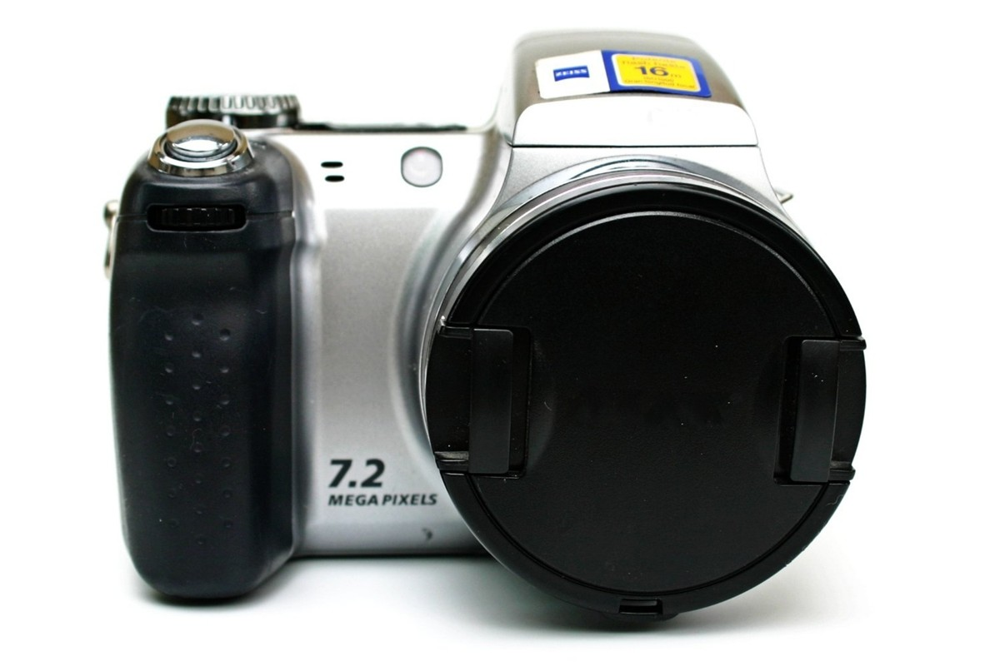
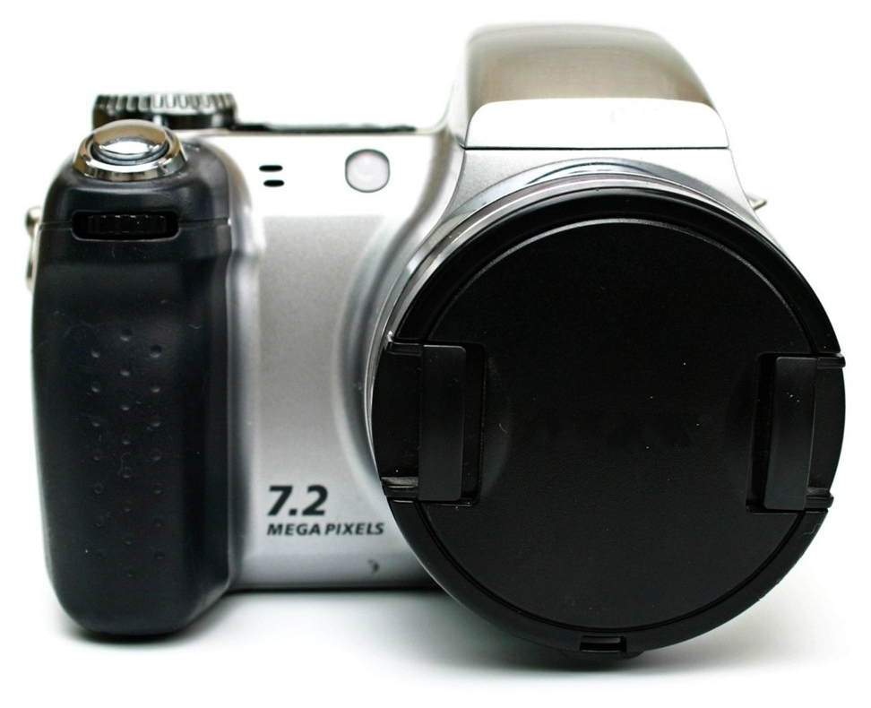

<h1 align="center">frame.</h1>
<h3 align="center">Less image prep. More products ready.</h3>

<strong>AI-assisted engineering, shaped around a real business need.</strong>

  
  
  

  <a href="docs/CASE_STUDY.md"><strong>Business case</strong></a> &middot;
  <a href="docs/TECHNICAL_GUIDE.md"><strong>Install &amp; screenshots</strong></a> &middot;
  <a href="docs/KNOWN_ISSUES.md"><strong>Known issues</strong></a>

## Prior business impact

| **100 images** | **Under 3 minutes** | **Over 90% less prep time** |
| :---: | :---: | :---: |
| Similar product photos | Including human review / corrections | From roughly 30 minutes |

*Reported results from my earlier employer tool. This public rebuild and its logo-cleanup extension have not been benchmarked at that volume. [Measurement notes](docs/CASE_STUDY.md#reported-business-results).*

## Before and after

| Before | After: selected sticker removed + excess whitespace trimmed |
| :---: | :---: |
|  |  |

Actual local-model output from this public rebuild. [CC0 photo credit](THIRD_PARTY_NOTICES.md#public-domain-camera) &middot; [More examples](docs/DEMO.md)

## Built for the business

I designed and built a similar internal tool **with AI-assisted coding** for my previous employer's catalog workflow. This independent recreation showcases that approach:

- **Automate routine prep:** batch cropping and selective background removal.
- **Clean selected logos / objects:** accept suggestions or draw a region, then preview and apply.
- **Review once, export together:** restore details, correct crops, and download one ZIP for catalog upload.

**Human backup matters:** background AI can damage pale devices; detection can miss or overselect objects. [Recovery workflow](docs/KNOWN_ISSUES.md) keeps the operator in control. Reviewed output is intended for production catalog use.

**AI-assisted, human-verified:** code review, focused regression tests, and real-image checks. [QA evidence](docs/QA.md)

[Technical decisions](docs/DECISIONS.md) &middot; [UI design](docs/UI_DESIGN.md) &middot; [MIT code license](LICENSE) &middot; [Asset/model notices](THIRD_PARTY_NOTICES.md)
