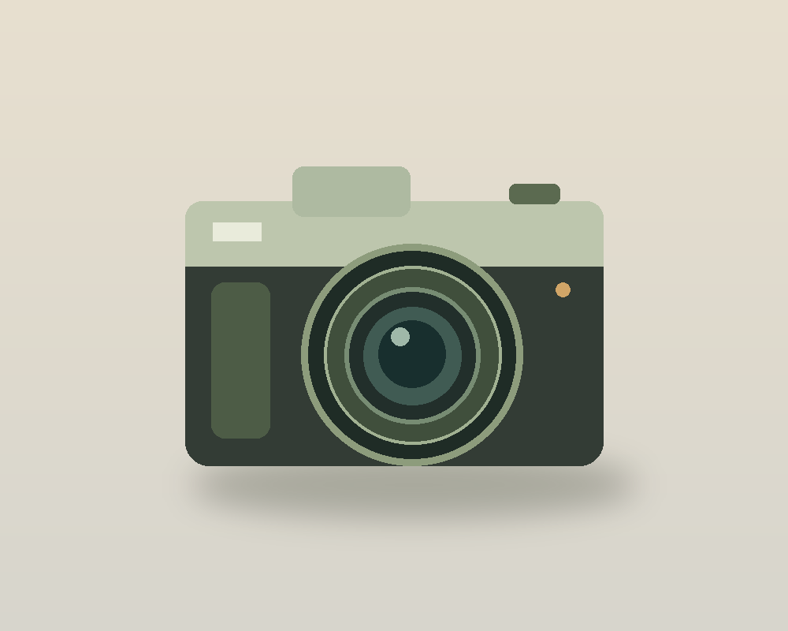

# Human review demo

## Quick example batch

1. Start the app and click **Try an example batch**.
2. Leave the white-background speaker, bottle, and headphones unflagged. They only need whitespace trimming.
3. Flag **travel-camera.png** for background removal because it has a colored backdrop. If a real iPhone photo is included in the batch, flag it too.
4. Choose padding and click the batch processing button. AI runs only on flagged images; every pending image is cropped.
5. Compare Original and Processed. Check outer edges, openings, controls, cables, and pale surfaces. These are places where automatic segmentation can make mistakes.
6. If a white product detail disappeared, choose **Restore** and paint only over the missing part. Restore copies source pixels, including their original background if you paint beyond the object. Use **Erase** to clean the excess.
7. If automatic crop cut too tightly or left excess space, choose **Crop** and draw the intended rectangle. Save edits. Use **Undo** to revert if needed.
8. Approve each reviewed image and export a ZIP. White output composites transparency on white; transparent output keeps the alpha mask. Approval filtering is optional.

## Real device photo

`iphone-15-pro-max.jpg` comes from Wikimedia Commons under CC BY 4.0; see [full attribution](../THIRD_PARTY_NOTICES.md). It is a real store photo, so segmentation quality is a review exercise rather than a promised perfect cutout. Inspect the phone frame and display, and decide whether any store stand belongs in your intended output.

## Actual before and after

These outputs were generated through the running application's API using local U²-Net on CPU, with 16 px padding and white output. The five-image batch completed successfully; only the camera and phone were flagged for AI. The exported ZIP contained five PNGs and a manifest. This verifies one small example, not a general throughput or accuracy target. A browser interaction review was not completed.

| Input | AI removal + automatic crop, before human approval |
| --- | --- |
|  |  |
|  |  |

The phone image above is by Ayamano2021, [CC BY 4.0](https://creativecommons.org/licenses/by/4.0/), [source](https://commons.wikimedia.org/wiki/File:Front_of_iPhone_15_Pro_Max.jpg). The input was resized and metadata stripped; the output additionally has AI background removal, automatic crop, and white compositing. The documentation preview is JPEG-encoded to reduce repository size; application exports remain PNG. No endorsement is implied.

The next human step is to inspect the full output, especially the phone outline and the camera's top controls. Use Restore only if a real product part is missing; use Erase for background remnants, or Crop when the bounding rectangle is wrong. The examples shown have no manual retouching and have not been marked approved in the app.

The four illustrations can be regenerated with `python scripts/generate_samples.py`. The photo is deliberately credited separately from project code. Demo outputs are examples of this implementation, not employer materials or a benchmark of the previous production tool.
