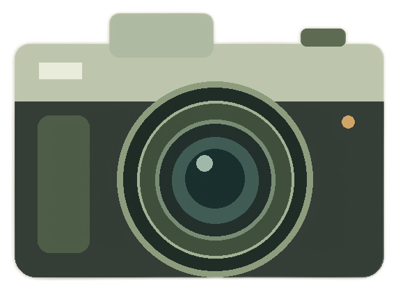
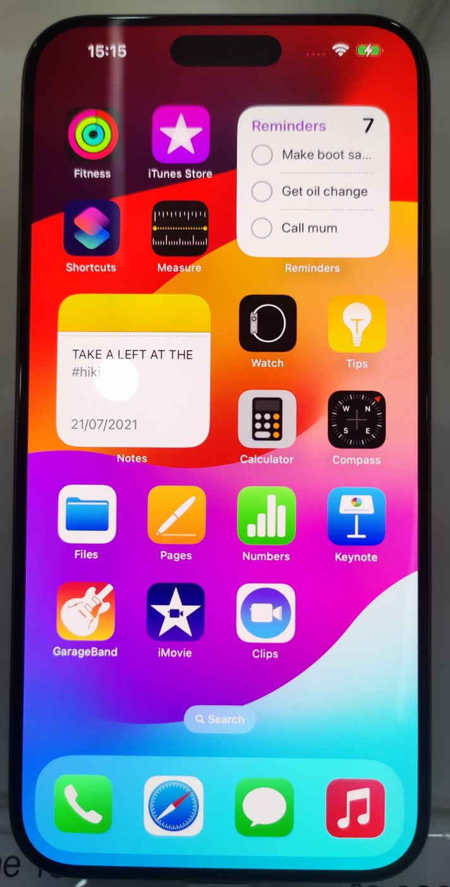
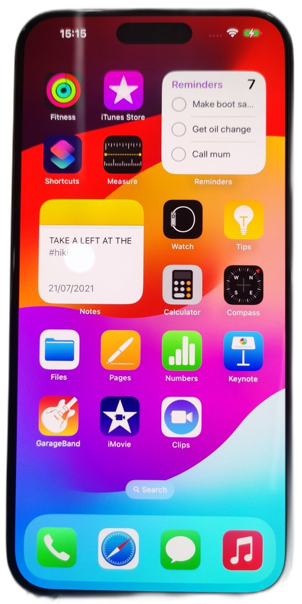
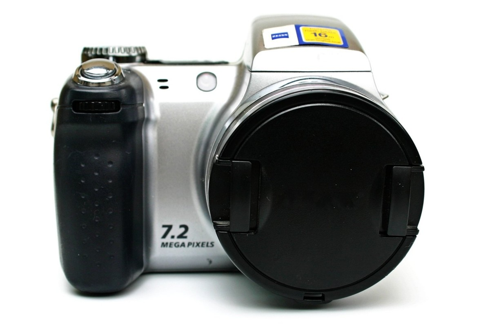
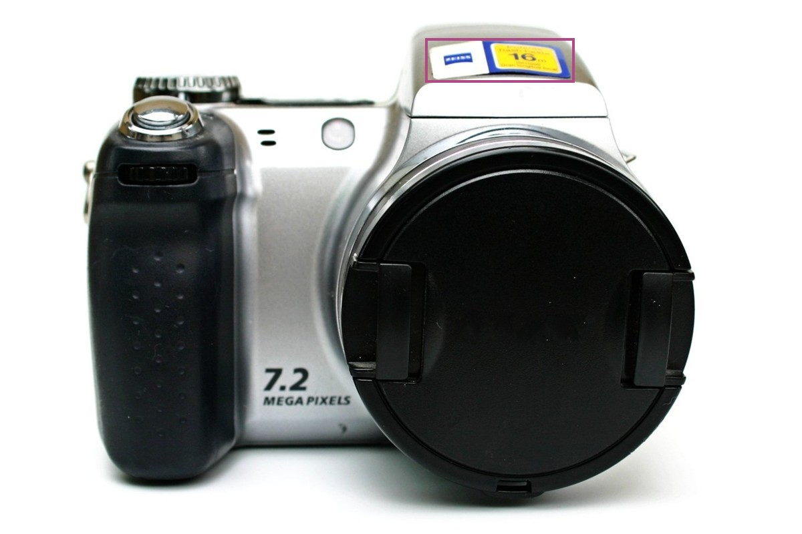
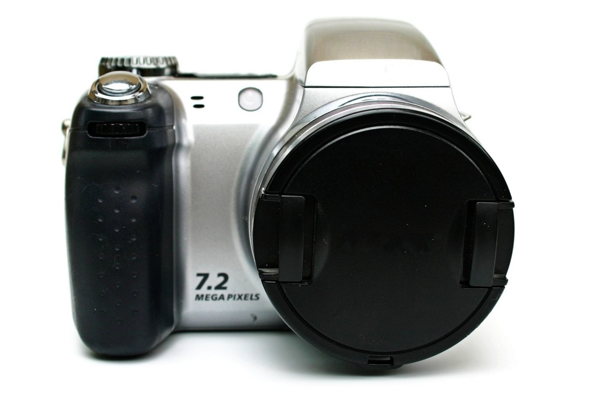

# Human review demo

This public demonstration recreates a workflow similar to software the author previously designed and built with AI-assisted coding for business product-image preparation. It uses a new implementation and public demo assets. These results are from this repository, with no company code or original business images included. A [side-by-side comparison is also shown directly in the README](../README.md#before-and-after).

## Quick example batch

1. Start the app and click **Try an example batch**.
2. Leave the white-background speaker, bottle, and headphones unflagged. They only need whitespace trimming.
3. Flag **travel-camera.png** for background removal because it has a colored backdrop. If a real iPhone photo is included in the batch, flag it too.
4. Choose padding and click the batch processing button. AI runs only on flagged images; every pending image is cropped.
5. Compare Original and Processed. Check outer edges, openings, controls, cables, and pale surfaces. These are places where automatic segmentation can make mistakes.
6. If a white product detail disappeared, choose **Restore** and paint only over the missing part. Restore copies source pixels, including their original background if you paint beyond the object. Use **Erase** to clean the excess.
7. If automatic crop cut too tightly or left excess space, choose **Crop** and draw the intended rectangle. Save edits. Use **Undo** to revert if needed.
8. Approve each reviewed image and export a ZIP. White output composites transparency on white; transparent output keeps the alpha mask. Approval filtering is optional.

## Real device photo

`iphone-15-pro-max.jpg` comes from Wikimedia Commons under CC BY 4.0; see [full attribution](../THIRD_PARTY_NOTICES.md). It is a real store photo, so segmentation quality is a review exercise rather than a promised perfect cutout. Inspect the phone frame and display, and decide whether any store stand belongs in your intended output.

## Actual before and after

These outputs were generated through the running application's API using local U²-Net on CPU, with 16 px padding and white output. The five-image batch completed successfully; only the camera and phone were flagged for AI. The exported ZIP contained five PNGs and a manifest. This verifies one small example, not a general throughput or accuracy target. A browser interaction review was not completed.

| Input | AI removal + automatic crop, before human approval |
| --- | --- |
|  |  |
|  |  |

The phone image above is by Ayamano2021, [CC BY 4.0](https://creativecommons.org/licenses/by/4.0/), [source](https://commons.wikimedia.org/wiki/File:Front_of_iPhone_15_Pro_Max.jpg). The input was resized and metadata stripped; the output additionally has AI background removal, automatic crop, and white compositing. The documentation preview is JPEG-encoded to reduce repository size; application exports remain PNG. No endorsement is implied.

The next human step is to inspect the full output, especially the phone outline and the camera's top controls. Use Restore only if a real product part is missing; use Erase for background remnants, or Crop when the bounding rectangle is wrong. The examples shown have no manual retouching and have not been marked approved in the app.

The four illustrations can be regenerated with `python scripts/generate_samples.py`. The photo is deliberately credited separately from project code. Demo outputs are examples of this implementation, not employer materials or a benchmark of the previous production tool.

## Business example: selective cleanup on a real CC0 camera photo

The business task is preparing a clean catalog asset while retaining genuine product details. Already-white photos can be crop-only. If an approved brief calls for removing a sticker, label, or logo, an operator enables cleanup and chooses only that region. Background removal, detection, and cleanup are independently optional.

| Original CC0 photo | Human-selected region | Actual LaMa preview |
| --- | --- | --- |
|  |  |  |

The middle rectangle was selected by inspecting the image; it is not a fabricated detector success. Local OWL-ViT suggestions are recorded in [QA results](qa-results.json). Suggestions can be selected or deselected. If detection misses the target, **Draw region** remains available.

The right image is a real local-model result. The operator can compare it with the original, discard it, or apply it. Applying creates an undoable revision; approval is a separate final pass. Tests verify that all pixels outside the selected rectangle and all alpha values remain unchanged before JPEG documentation encoding.

| Operator decision | App behavior | Business value |
| --- | --- | --- |
| This photo is already clean. | Leave background AI and cleanup off; crop only. | Avoid unnecessary processing and alteration. |
| This image needs background removal. | Flag that image and process the batch. | Apply segmentation only where it helps. |
| An approved region needs cleanup. | Detect suggestions or draw rectangles, then preview inpainting. | Keep a human responsible for the exact alteration. |
| AI lost a product detail or drew the wrong crop. | Restore source pixels, undo, or crop by hand. | Recover without re-uploading the source. |
| The result is ready. | Approve and export PNGs with a manifest in one ZIP. | Fit the existing catalog upload workflow. |

Photo: **Digital Camera**, Homero Nunez Chapa, [CC0 Public Domain](https://creativecommons.org/publicdomain/zero/1.0/), [source](https://www.publicdomainpictures.net/en/view-image.php?image=153769&picture=digital-camera). The images above are resized JPEG documentation previews. See [QA scope and limits](QA.md); no throughput or sales impact is inferred from this small demonstration.
